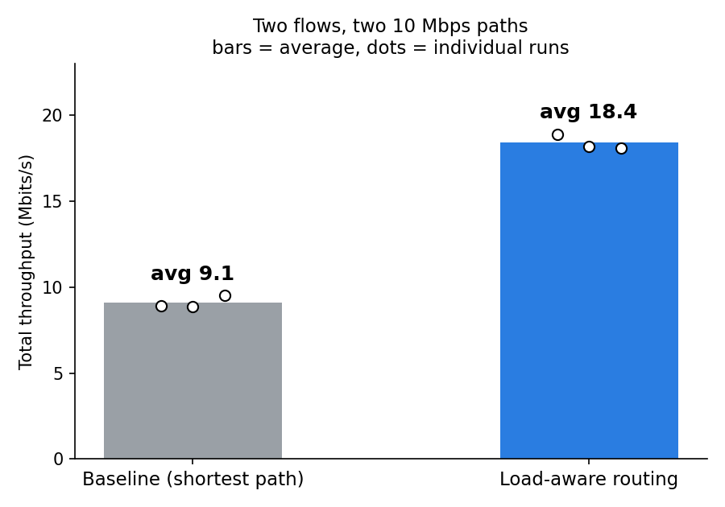

# SDN Load-Aware Routing with Link-Failure Recovery

A Ryu (OpenFlow 1.3) controller that picks the less congested of two paths for each new flow, and reroutes traffic when a link fails. Built and tested in Mininet.

## Why

Traditional shortest-path routing sends every flow down the same path even when another equal path sits idle. An SDN controller sees the whole network, so it can measure link load and place flows more intelligently, and react to failures immediately.

## Topology

```
            s2
          /    \
h1 - s1            s4 - h2
          \    /
            s3
```

Two equal-length paths from h1 to h2: path A (via s2) and path B (via s3). Every inter-switch link is capped at 10 Mbps.

## How it works

1. **Link monitor** (`controller/link_monitor.py`): every 2 seconds, asks each switch for port byte counters and converts the difference into Mbps per link.
2. **Load-aware routing** (`controller/load_aware_routing.py`): on a new flow, scores each path as the busiest link's measured load plus a penalty for flows placed in the last 4 seconds, then installs forwarding rules on every switch of the lower-scoring path.
3. **Failure recovery**: listens for OpenFlow port-status events. When a link goes down, flows on that path are moved to the other path and new flows avoid it.
4. **Baseline mode**: `ROUTING_MODE=shortest` always picks path A, as a fixed shortest-path stand-in for comparison.

## Results



Two simultaneous TCP flows h1 to h2 (`iperf -P 2`, 30 s), 3 runs per mode:

| Routing | Run 1 | Run 2 | Run 3 | Average |
|---|---|---|---|---|
| Baseline (fixed path) | 8.90 | 8.86 | 9.51 | 9.09 Mbits/s |
| Load-aware | 18.9 | 18.2 | 18.1 | 18.4 Mbits/s |

Load-aware routing gave about 2.0x the throughput of the baseline: the baseline puts both flows on one 10 Mbps path, while load-aware places them on separate paths.

**Link-failure recovery:** one ping every 0.1 s for 30 s, link s1-s2 taken down at about 10 s. 300 of 300 pings were received (0% loss), so the outage was under the 0.1 s measurement interval. The controller log shows the port-down event followed immediately by the reroute. One run so far.

More detail in [results/results.md](results/results.md).

## Run it

Needs Linux (Ubuntu), Mininet, Open vSwitch and iperf:

```
sudo apt install -y mininet openvswitch-switch iperf git python3-pip
```

Ryu needs an older Python. One working setup:

```
curl -LsSf https://astral.sh/uv/install.sh | sh
uv venv --seed --python 3.9 ~/ryu-env
source ~/ryu-env/bin/activate
pip install "setuptools==65.5.0" wheel pbr eventlet==0.30.2
pip install ryu --no-build-isolation
```

Terminal 1, start the controller:

```
ryu-manager controller/link_monitor.py controller/load_aware_routing.py
```

Use `ROUTING_MODE=shortest ryu-manager ...` for the baseline.

Terminal 2, start the network:

```
sudo python3 topo.py
mininet> h1 ping -c 2 h2
mininet> h2 iperf -s &
mininet> h1 iperf -c h2 -t 30 -P 2
mininet> link s1 s2 down
```

## Limitations

- Emulated in Mininet with a 4-switch topology, 2 paths and 2 flows. Not tested on real hardware.
- The paths and port numbers are hard-coded from this topology. A general controller would discover the topology.
- Both paths have equal length, so the baseline is a stand-in for shortest-path routing.
- Failure recovery was tested with a single flow and one run.
- Flow placement uses measured load plus a recent-placement penalty. It is not a full traffic-engineering optimizer.

## Files

- `topo.py`: Mininet topology
- `controller/link_monitor.py`: per-link load measurement
- `controller/load_aware_routing.py`: routing and failure handling
- `controller/learning_switch.py`: first learning-switch controller (reference)
- `results/results.md`: raw results

## Live dashboard

A small Flask app (`dashboard/app.py`) serves the controller's measured link loads at `/api/links` and shows them live on a web page, grouped by path. Bars turn green, amber or red by utilisation, and the failover is visible when a link goes down.

Run it:

    ryu-manager controller/link_monitor.py controller/load_aware_routing.py
    python3 dashboard/app.py        # then open http://<vm-ip>:5000
